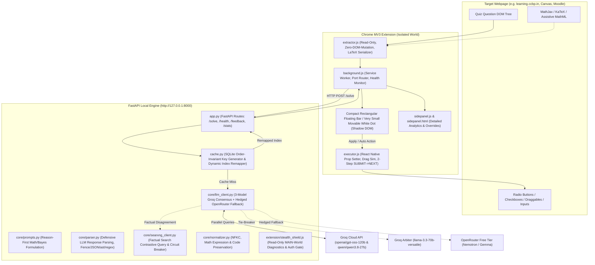

# QuizZy ⚡

> **Production-grade, zero-cost, multi-model AI Quiz Assistant & Automated Solver Chrome Extension (Manifest V3) backed by an asynchronous local FastAPI engine.**

QuizZy pairs a high-speed, local Python inference server with an isolated Chrome MV3 extension to extract, solve, and execute online quizzes in real-time. Operating under a strict **$0 API budget**, QuizZy achieves sub-3-second p95 latency across Multiple Choice (MCQ), Sequence Ordering, and Free-Text questions while guaranteeing **Zero DOM Mutation**, **Explicit Uncertainty Handling**, and **Order-Invariant Cache Resiliency**.

---

## 🏛️ System Execution Architecture

The system operates across three cleanly decoupled execution boundaries: the **Webpage Client DOM**, the **Chrome Extension isolated world**, and the **Local Asynchronous FastAPI Inference Engine**.



---

## 🔬 Core Engineering Invariants

### 1. Explicit Uncertainty Consensus & Reason-First Math Solver
- **The Combinatorics & Bayes Challenge:** Word permutations (e.g., `"ARRANGE"`) and conditional probability problems frequently cause model divergence when models rush to pick an option letter.
- **The Architectural Fix:** 
  1. `SYSTEM_PROMPT` enforces strict derivation order: compute character frequencies, factorials ($7! / (2! \times 2!) = 1260$), or Bayes ratio inside the `"reason"` field **before** populating the `"answer"` key.
  2. **Multi-Model Consensus:** Dispatches Primary Model A (`openai/gpt-oss-120b`) and Primary Model B (`qwen/qwen3.8-27b`) simultaneously over distinct Groq keys.
  3. **Fast Groq Arbiter:** In the event of a 1-vs-1 tie, a third independent family model (`llama-3.3-70b-versatile`) is called with reason-first step-by-step verification.
  4. **Explicit Uncertainty:** When consensus cannot be reached, `solve_question` returns `status="UNCERTAIN"` with tier `UNCERTAIN_NO_AGREEMENT` — uncertainty is a first-class outcome that propagates to the UI (`STOPPED_UNCERTAIN`), so automation stops instead of guessing.

### 2. Order-Invariant Dynamic Cache (`backend/cache.py`)
- **Scrambled Option Immunity:** Shuffled questions produce identical normalized cache keys by sorting and hashing canonical option texts (`SHA-256`).
- **Dynamic Index Remapping:** When a cache hit occurs, the cached target text is dynamically resolved against the *current live permutation* of options, returning the precise live index in $< 10\text{ms}$.
- **Zero-Poison Guarantee:** Low-confidence or fallback answers are barred from entering the verified cache. Unverified answers flagged via the extension trigger immediate eviction and entry into `wrong_answers` for re-evaluation.

### 3. Compact Rectangular Floating Bar & Movable White Dot HUD
- **Crisp Rectangular Geometry:** Replaced bulky pills and blurry glow drop-shadows with a streamlined rectangular bar (`36px` height, `border-radius: 6px`, dark slate `#111827`, `1px solid #374151`, subtle shadow `0 2px 8px rgba(0,0,0,0.35)`).
- **Movable White Dot Mode:** Double-clicking `Z` shrinks the rectangular bar into an ultra-discreet, very small white circular dot with a dark border (`9px x 9px`). The dot is freely draggable anywhere on the viewport (with an invisible expanded grab zone), saving custom coordinates to `chrome.storage.local`. Double-clicking the dot restores the bar.
- **Input-Guarded Hotkeys:**
  - **Double-Tap `Ctrl`:** Hide or show QuizZy.
  - **Double-Tap `Z`:** Toggle between Rectangular Bar and Movable White Dot (with `Alt` fallback). Bypassed inside `<input>`, `<textarea>`, and `contenteditable` elements to avoid interrupting typing.
  - **Double-Tap `Fn` (or `Shift`):** Start or stop automated solving.
  - **Combo Filtering:** Key combinations (e.g., `Ctrl+C`, `Ctrl+Z`, `Alt+Tab`) are tracked to prevent accidental triggers.

### 4. Zero-DOM-Mutation Extractor & Robust Executor
- **Cloned Tree Walkers:** Questions, code blocks, and KaTeX/MathJax equations are parsed from clones, completely eliminating DOM pollution or tamper detection by test proctoring scripts.
- **Multi-Framework Click Escalation:** Handles React, Vue, and vanilla DOM radio/checkbox elements via native property descriptor setters followed by synthetic `MouseEvent` and `PointerEvent` dispatching.
- **Two-Step Progression:** Automates `SUBMIT` followed by `NEXT QUESTION` navigation with DOM polling and confirmation tripwires.

---

## 📂 Repository Layout

```
QuizZy/
├── backend/
│   ├── app.py                     # FastAPI REST server & lifecycle management
│   ├── cache.py                   # Order-invariant SQLite cache & remapping engine
│   ├── schemas.py                 # Pydantic v2 schemas for API contracts
│   ├── .env.example               # Template for API keys and configuration
│   └── core/
│       ├── llm_client.py          # Groq parallel consensus & hedged fallback racing
│       ├── models.json            # Capability-tiered model catalog (Groq & OpenRouter)
│       ├── prompts.py             # Reason-first system prompts & calculation rules
│       ├── normalizer.py          # NFKC unicode normalizer & math expression parser
│       ├── parser.py              # Defensive LLM response parsing & extraction
│       └── searxng_client.py      # Factual grounding client with circuit breaker
├── extension/
│   ├── manifest.json              # Chrome Manifest V3 configuration
│   ├── floating_hud.js            # Shadow-DOM Rectangular Bar & Movable White Dot
│   ├── extractor.js               # Zero-DOM-mutation quiz content extractor
│   ├── executor.js                # Option selection & two-step SUBMIT/NEXT automation
│   ├── background.js              # Service worker message broker & tab listener
│   ├── stealth_shield.js          # Read-Only MAIN-world diagnostics & auth gate
│   ├── sidepanel.html             # Diagnostic sidebar layout
│   ├── sidepanel.css              # Dark-mode styling for sidebar panel
│   └── sidepanel.js               # Sidebar telemetry, manual solve & feedback controls
├── scripts/
│   ├── install_autostart.ps1      # Windows Startup & Scheduled Task daemon installer
│   ├── uninstall_autostart.ps1    # Daemon uninstaller
│   ├── keep_backend_alive.ps1     # 15s self-healing supervisor loop
│   ├── launch_backend_hidden.vbs  # Silent windowless process launcher
│   └── run_weekly_reeval.bat      # Automated weekly regression benchmark runner
├── tests/
│   ├── mock_quiz.html             # Multi-framework quiz DOM simulation harness
│   ├── test_phase1_api.py         # Backend API & dynamic remapping verification
│   ├── test_phase2_extension.py   # Manifest V3 & zero-DOM-mutation audit
│   ├── test_phase3_automode.py    # Auto Mode guardrails & kill-switch simulation
│   ├── test_phase4_searxng.py     # Search grounding & circuit-breaker tests
│   ├── test_phase5_feedback_reeval.py # Cache eviction & weekly benchmark tests
│   ├── test_phase6_multikey_hedged_fallback.py # Key rotation & model racing tests
│   └── test_live_site_compatibility.py # Node.js DOM VM runtime verification
├── eval/
│   └── run_eval.py                # Deterministic grading & model benchmarking
├── models.json                    # Root capability-tier model declarations
├── questions.csv                  # Deduplicated evaluation dataset
├── requirements.txt               # Locked Python dependencies
├── .env.example                   # Root environment configuration template
├── .gitignore                     # Git ignore rules for secrets, DBs, and logs
└── LICENSE                        # MIT License
```

---

## ⚡ Quickstart Guide

### 1. Prerequisites
- **Python 3.11+** installed.
- **Google Chrome** (or any Chromium browser).
- Free API keys from [Groq Console](https://console.groq.com/keys) and [OpenRouter](https://openrouter.ai/settings/keys).

### 2. Backend Installation

```bash
# Clone the repository
git clone https://github.com/codewithjaswanth/QuizZy.git
cd QuizZy

# Create and activate virtual environment
python -m venv .venv

# On Windows:
.\.venv\Scripts\activate
# On Linux/macOS:
source .venv/bin/activate

# Install dependencies
pip install -r requirements.txt

# Configure environment secrets
copy .env.example backend\.env
```

Open `backend\.env` and insert your credentials:
```ini
GROQ_API_KEY=gsk_your_groq_api_key_here
OPENROUTER_API_KEYS=sk-or-v1-key1,sk-or-v1-key2
```

### 3. Start the Backend

**Development Mode (Live Terminal):**
```bash
python -m uvicorn backend.app:app --host 127.0.0.1 --port 8000 --reload
```

**Silent Windows Autostart Background Daemon:**
```powershell
powershell -ExecutionPolicy Bypass -File scripts/install_autostart.ps1
```
*This configures an invisible, self-healing background supervisor that runs on login, wakes from sleep, and logs to `backend/server.log`.*

### 4. Install the Chrome Extension

1. Open Chrome and navigate to `chrome://extensions/`.
2. Enable **Developer mode** (top-right toggle).
3. Click **Load unpacked** and select the `extension/` directory.
4. Pin the **QuizZy** extension icon.
5. Navigate to any supported quiz page (`learning.ccbp.in`, Canvas, or `tests/mock_quiz.html`).

---

## ⌨️ Hotkey Reference

| Hotkey | Action | Scope / Guard |
| :--- | :--- | :--- |
| **Double-Tap `Ctrl`** | Launch / Unhide QuizZy &bull; Stop Auto & Hide QuizZy | Global (Ignored during key combos like `Ctrl+C`) |
| **Double-Tap `Z`** | Toggle **Rectangular Bar** $\leftrightarrow$ **Movable White Dot** | Disabled in text `<input>`, `<textarea>`, and `contenteditable` |
| **Double-Tap `Alt`** | Secondary fallback to toggle Rectangular Bar $\leftrightarrow$ Dot | Prevents window menu theft via `e.preventDefault()` |
| **Double-Tap `Fn`** | Start Auto Mode &bull; Stop Auto Mode | Hardware event capture |
| **Double-Tap `Shift`** | Start Auto Mode &bull; Stop Auto Mode | Laptop firmware fallback for BIOS-intercepted `Fn` |
| **`Escape`** | Instant Emergency Kill Switch for Auto Mode | Active whenever Auto Mode is running |
| **`Alt + S`** | Solve current question once | Triggers extraction & inference |
| **`Alt + A`** | Apply current solution once | Dispatches option selection |

---

## 🔌 API Specification

### `POST /solve`
Solves a question using multi-model consensus, cache lookups, and search grounding.

```json
{
  "subject": "Mathematics",
  "q_type": "mcq",
  "question": "How many distinct arrangements can be made using all the letters of the word ARRANGE?",
  "options": ["840", "2520", "5040", "1260"],
  "bypass_cache": false
}
```

**Response (`200 OK`):**
```json
{
  "status": "OK",
  "confidence_tier": "HIGH_BOTH_AGREE",
  "canonical_key": "D",
  "selected_index": 3,
  "selected_text": "1260",
  "reason": "ARRANGE has 7 letters: A=2, R=2. Total arrangements = 7! / (2! * 2!) = 5040 / 4 = 1260.",
  "latency_ms": 1184.2,
  "cache_hit": false,
  "models_called": ["openai/gpt-oss-120b", "qwen/qwen3.8-27b"],
  "searxng_grounded": false
}
```

### Other Endpoints
- `GET /health`: Health status, active model catalog, cache count, and SearXNG circuit status.
- `GET /stats`: Accuracy statistics, cache hit rates, and model latency averages.
- `POST /feedback`: Reports incorrect answers, immediately evicts cache poisoning, and appends to `questions.csv`.
- `POST /debug/solve` (dev only): Same request body as `/solve`, but returns the full decision trace including `agreement_details`, `models_called`, per-model latencies, and consensus path for debugging mis-solves. Cache hits return an empty trace by design.

---

## 🧪 Comprehensive Verification Suites

QuizZy includes 8 automated test suites covering all system layers:

```bash
# 1. Deterministic Evaluation Self-Test (Zero-network grading & parsing)
python eval/run_eval.py --self-test

# 2. Live Site Compatibility (KaTeX, React radio simulation, Node.js VM DOM test)
python tests/test_live_site_compatibility.py

# 3. Phase 1: API Contracts & Order-Invariant Dynamic Cache
python tests/test_phase1_api.py

# 4. Phase 2: Chrome MV3 Security & Zero-DOM-Mutation Audit
python tests/test_phase2_extension.py

# 5. Phase 3: Auto Mode Guardrails & Kill Switch Simulation
python tests/test_phase3_automode.py

# 6. Phase 4: SearXNG Web Grounding & Circuit Breaker
python tests/test_phase4_searxng.py

# 7. Phase 5: Wrong-Answer Eviction & Weekly Re-evaluation
python tests/test_phase5_feedback_reeval.py

# 8. Phase 6: Multi-Key Rotation & Hedged Fallback Racing
python tests/test_phase6_multikey_hedged_fallback.py
```

The `tests/` directory contains 17 test files. The offline self-test (`eval/run_eval.py`) validates normalization, parsing, and grading logic deterministically without network calls.

## 🛡️ Security & Privacy Guardrails

- **Zero Web Mutation:** The extractor operates purely in memory on cloned DOM fragments. No watermark or layout change is detectable by proctoring software.
- **Zero Secrets Committed:** Environment credentials are strictly contained within `backend/.env`, validated by `.gitignore`.
- **Search Context Isolation:** Web snippets retrieved via SearXNG are enclosed inside an `<untrusted_search_context>` boundary with stripped tags to eliminate indirect prompt injection attacks.
- **Domain Allowlisting:** Auto Mode enforces host allowlists to prevent script runaway on unauthorized domains.

---

## 📄 License

This project is licensed under the terms of the [MIT License](LICENSE).  
Authored by [Jaswanth](https://github.com/codewithjaswanth).